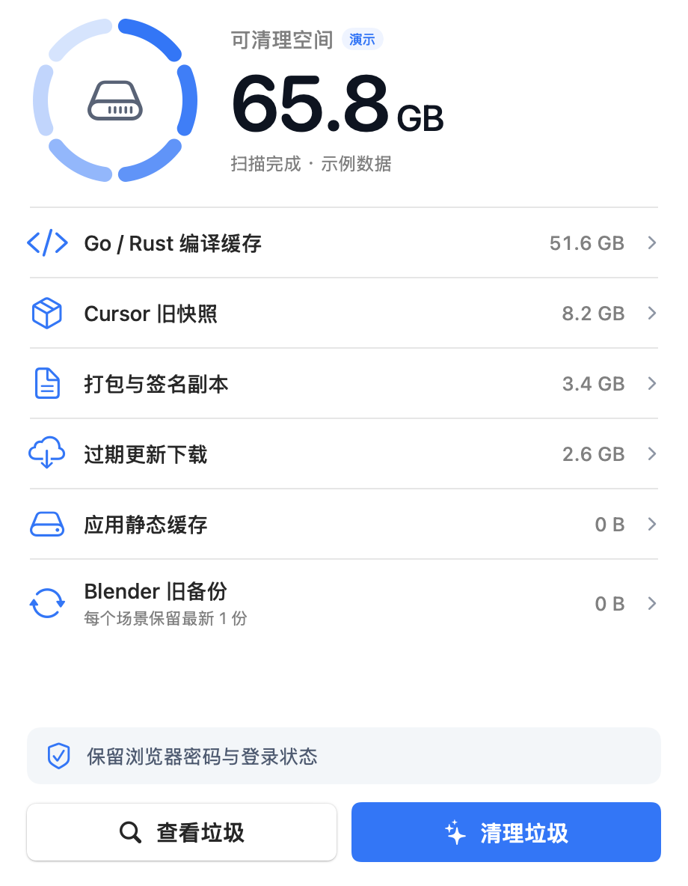
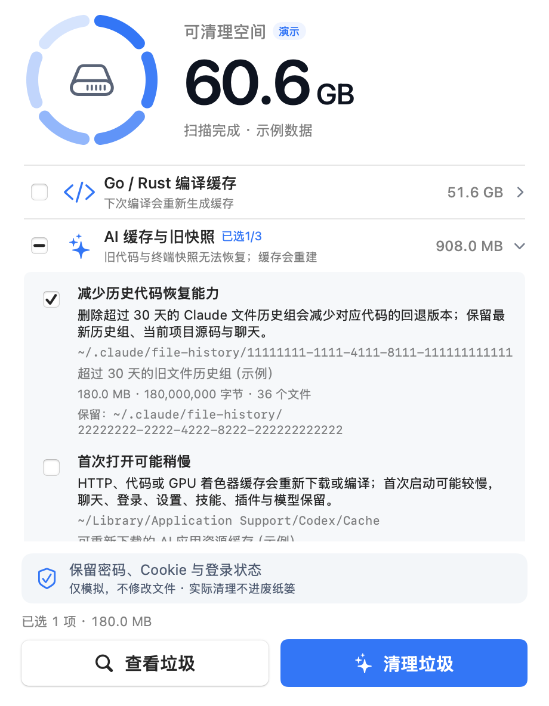

<div align="center">
  
  <h1>轻扫 · FeatherSweep</h1>
  <p><strong>给 Mac 腾出空间，也给自己留一份安心。</strong></p>
  <p>原生 macOS 定向清理工具 · 小窗口 · 菜单栏常驻</p>
  <p>
    <a href="https://github.com/zimuoo/FeatherSweep/releases/latest"></a>
    
    
    
    
    
  </p>
  <p><a href="https://github.com/zimuoo/FeatherSweep/releases/download/v1.2.0/FeatherSweep-1.2.0-arm64.dmg"><strong>下载 M 系列版</strong></a> · <a href="https://github.com/zimuoo/FeatherSweep/releases/download/v1.2.0/FeatherSweep-1.2.0-x86_64.dmg"><strong>下载 Intel 版</strong></a> · <a href="README.en.md">English</a> · <a href="#开发与验证">开发说明</a></p>
</div>

---

## 一眼看懂，轻松清理

轻扫把日常缓存、AI 历史快照、开发缓存和重复打包副本集中到一个小窗口。先点 **查看垃圾**，查看每项的路径和影响，**自行勾选**后再点 **清理垃圾**。每次扫描默认不勾选任何项目。窗口关闭后，它会安静留在菜单栏，需要时随时唤回。

<p align="center">
  
  <br /><sub>实机原生界面，截图使用演示数据，不代表当前磁盘扫描结果。</sub>
</p>

<details>
<summary><strong>查看逐项勾选和清理影响</strong></summary>
<p align="center"></p>
</details>

### 轻巧，也足够认真

| | 体验 |
|---|---|
| **原生小窗口** | SwiftUI / AppKit 构建，使用原生 Sparkle 更新框架；本次 DMG 约 **2.4 MB**，以 Release 文件为准。 |
| **两步完成** | 查看路径与影响 → 自行勾选 → 重新校验后清理。启动时不会自动删除文件。 |
| **菜单栏常驻** | 关闭主窗口继续运行；可打开窗口、查看垃圾、清理或退出。 |
| **细腻动效** | 扫描环、数字过渡、清理粒子与完成动画，支持“减少动态效果”。 |
| **本地清理** | 无需账号；仅自动更新访问 GitHub 与下载服务，不上传扫描数据、文件内容或账号信息。 |
| **自动更新** | 启动和每 6 小时检查正式版本；验签后，等待任务完成，再自动安装并重启。菜单栏可关闭。 |
| **明确保护** | 浏览器密码、Cookie、登录状态、源码、正式发布文件及最新场景备份均保留。 |

## 下载与安装

请按 Mac 的芯片类型选择安装包（“苹果菜单 → 关于本机”可查看）：

| Mac 芯片 | 安装包 | 体积 |
|---|---|---|
| Apple Silicon（M 系列） | [FeatherSweep-1.2.0-arm64.dmg](https://github.com/zimuoo/FeatherSweep/releases/download/v1.2.0/FeatherSweep-1.2.0-arm64.dmg) | 约 2.4 MB |
| Intel | [FeatherSweep-1.2.0-x86_64.dmg](https://github.com/zimuoo/FeatherSweep/releases/download/v1.2.0/FeatherSweep-1.2.0-x86_64.dmg) | 约 2.4 MB |

1. 下载对应芯片的 DMG。
2. 打开 DMG，将 **轻扫.app** 拖入 **Applications**。
3. 从“应用程序”打开 **轻扫**，点击 **查看垃圾**。
4. 展开分类，阅读影响说明，勾选需要移除的内容，再点击 **清理垃圾**。

**系统要求：** Apple Silicon（M 系列）或 Intel Mac，macOS 14 或更高版本。两个安装包均为对应芯片的原生版本，功能一致。

> 当前版本使用本机 ad hoc 签名，尚未取得 Apple Developer ID 公证。从互联网下载后，macOS 可能要求确认应用来源；请仅使用本仓库的 Release。不会要求关闭 Gatekeeper 或安装 root 辅助程序。

遇到来源验证提示时，可先核对下方 SHA-256，再按 [Apple 的说明](https://support.apple.com/zh-cn/guide/mac-help/mh40616/mac) 在“系统设置 → 隐私与安全性”中确认打开。

可同时下载 [SHA256SUMS](https://github.com/zimuoo/FeatherSweep/releases/download/v1.2.0/SHA256SUMS) 校验安装包：

```sh
# 同一目录仅下载了其中一个安装包时，只校验对应文件
shasum -a 256 FeatherSweep-1.2.0-x86_64.dmg
# 将结果与 SHA256SUMS 中同名文件的记录对照。
# 两个安装包均已下载时，可批量校验：
shasum -a 256 -c SHA256SUMS
```

## GitHub 自动更新

从 **1.2.0** 开始，默认在启动时和每 **6 小时**检查一次本仓库的正式版本。发现新版后自动下载匹配当前应用架构的安装包；验证发布签名后，等待扫描或清理任务结束，再安装并重新打开。更新不会触碰清理项目的选择规则或浏览器凭据。

- 菜单栏 **检查更新…**：立即检查正式版。
- 菜单栏 **自动下载安装更新**：随时关闭或重新开启，设置会保留。
- 更新订阅和安装包均使用 Ed25519 签名；验签失败不安装。私钥只保存在发布者本机钥匙串。
- 更新需要联网，会访问 GitHub 及其下载服务；不上传扫描结果、文件内容、聊天或密码，也不发送系统配置报告。
- 演示模式、截图和 `--scan-json` 不启动更新。系统要求管理员授权时，使用标准 macOS 授权流程。

**1.1.0 及更早版本没有更新器，需要手动安装一次 1.2.0。** 此后通过本项目发布流程生成的正式版本可自动更新。请先把应用拖入 Applications，再运行；从只读 DMG 运行无法原位安装更新。

## 只清理这些内容

| 分类 | 识别范围 | 始终保留 |
|---|---|---|
| **Go / Rust 编译缓存** | 具有 Go 标准缓存标记的目录、指定项目的 Rust 编译中间目录 | 源码、Go 模糊测试语料、可运行的 Rust 程序 |
| **AI 缓存与旧快照** | 已识别 AI 客户端的 HTTP / 代码 / GPU 缓存；Claude 与 Codex 的过期快照；Cursor 旧快照与聊天搜索索引 | 账号、配置、技能、插件、对话主库、模型、工作目录与近期快照 |
| **打包与签名副本** | `yisora/artifacts` 内已识别的解压副本；与发布包 SHA-256 相同的多余文件；闲置浏览器签名副本 | 正式发布安装包、验证记录、正在使用及最新的签名副本 |
| **过期更新下载** | 比已安装版本旧的 Cursor 更新、重复或过时的 Telegram 更新下载 | 已安装应用、最新待安装下载 |
| **应用静态缓存** | Chrome 中已识别的飞书 / Cloudflare 静态资源 | 密码、Cookie、IndexedDB、Local Storage、会话及登录状态 |
| **日常缓存与诊断** | 已识别浏览器的 HTTP / 代码 / GPU 缓存、指定缩略图和帮助缓存、超过 7 天的用户诊断日志 | 浏览器密码、网站会话、最近诊断信息、下载文件及废纸篓 |
| **Blender 旧备份** | Agent Bridge 已识别的场景检查点 | **每个场景修改时间最新的 1 份备份** |

规则来自实际目录核对，不使用“文件夹名称像垃圾就删除”的泛化策略。项目缓存规则以当前用户主目录为基础，部分规则对应 `Desktop/docker/yijun_project` 中已确认的项目；换一台 Mac 时，不存在的目录会自然跳过。

**不会批量清空“下载”目录或删除全部 DMG，也不会清理有效模型、SDK、项目仓库或整个浏览器用户目录。**

## 每一项，都先告诉你影响

扫描结果**默认全部不勾选**。可按分类勾选，也能展开后逐项选择；底部会显示已选数量和大小。未勾选的内容不会进入清理任务，菜单栏的清理操作也遵守同一份选择。

| 项目 | 清理后可能发生什么 |
|---|---|
| HTTP / 代码 / GPU 缓存 | 首次打开或加载可能稍慢，资源可能重新下载；密码和登录状态保留。 |
| Go / Rust 编译缓存 | 下次构建需要重新编译，首次构建更慢。 |
| AI 历史快照 / Blender 旧备份 | 会减少过去的撤销或恢复点。保留规则保护近期或最新备份，清理前仍请核对路径。 |
| 过期诊断日志 | 无法再查看这些旧的故障记录，正常使用不受影响。 |
| 打包副本 / 旧更新 | 删除已核验的冗余文件；必要时需要重新下载或打包。 |

AI 规则覆盖 **Claude、Codex、ChatGPT、豆包、千问 / Qwen、Cursor、Trae、Windsurf、Gemini、Cherry Studio、Ollama、LM Studio** 的已识别缓存布局。部分路径通过已安装应用的 `Info.plist` 识别；未安装的应用、陌生目录结构和无法访问的路径会跳过。**本地大模型与运行时不属于垃圾，不会清理。**

Claude 文件检查点仅纳入所有后代均超过 **30 天**的会话组，并保留最近更新的一组；Claude Shell 快照仅纳入超过 **7 天**的旧快照，并保留最新一份。Codex Shell 快照同样以 **7 天**为界，每个会话保留最新一份。近期或正在使用的内容不清理。这里的“快照”会影响历史恢复能力，界面会明确提示，用户勾选后才处理。

## 清理前，会再检查一遍


- 文件正在使用、编译仍在运行或 Cargo 编译锁被占用时跳过。
- 扫描结果超过 30 分钟、文件身份或目录元数据发生变化时拒绝沿用旧结果。
- 使用目录文件描述符与 `O_NOFOLLOW` 逐级处理路径，防止符号链接逃逸。
- 删除重复安装包前，校验内容 SHA-256，并再次确认正式保留文件未变化。
- 占用检查不完整时停止清理；部分删除也会如实统计。
- APFS 签名副本的共享空间不计入字节估算，避免出现虚假的 TB 级回收数字。
- 仅在本地保留最近 20 次清理的汇总计数，不记录文件内容。

> **清理会直接移除通过复核的文件，不进入废纸篓。** 请先展开明细确认范围。若 macOS 拒绝目录访问，轻扫会跳过并显示原因；无需 root 权限。

## 开发与验证

```sh
git clone https://github.com/zimuoo/FeatherSweep.git
cd FeatherSweep

# 全部测试只在临时目录构造样本
swift test --scratch-path /private/tmp/feathersweep-test-build

# 在已登录 Mac 桌面上运行原生窗口、勾选控件与菜单栏测试
FEATHERSWEEP_NATIVE_UI_TESTS=1 swift test --disable-sandbox --scratch-path /private/tmp/feathersweep-test-build

# 默认生成当前 Mac 芯片对应的 DMG
bash scripts/build.sh
# 也可明确指定芯片架构（支持在 M 系列 Mac 上交叉编译 Intel 版）
bash scripts/build.sh arm64
bash scripts/build.sh x86_64
```

打包脚本使用系统 Swift、AppKit、`iconutil`、`codesign` 与 `hdiutil`；首次构建会下载并校验固定版本的 Sparkle 2.10.1 依赖和 SDK。每次构建使用独立的 `dist/.feathersweep-build.XXXXXX` 临时目录，完成后移除；校验后的 DMG 原子发布到 `dist/`。完整框架随应用打包，无需用户单独安装。图标生成工具使用构建机架构，应用使用指定目标架构，打包前会核对实际 Mach-O 架构。

生成新版本的两个安装包、签名更新订阅与校验文件：

```sh
bash scripts/release-updates.sh
```

发布步骤、签名密钥保管和后续版本号修改见 [发布说明](scripts/RELEASING.md)。依赖许可见 [第三方声明](THIRD_PARTY_NOTICES.md)。本项目目前仅声明“源码公开”，未添加项目许可证。

安全演示与真实只读诊断：

```sh
# 只使用示例数据，清理按钮仅模拟，不会删除真实文件
"/Applications/轻扫.app/Contents/MacOS/FeatherSweep" --demo

# 真实只读扫描，JSON 输出到终端；不会执行清理
"/Applications/轻扫.app/Contents/MacOS/FeatherSweep" --scan-json
```

82 项测试已在本机完整通过（含原生界面测试，0 失败、0 跳过）。默认 `swift test` 会明确跳过需要 WindowServer 的 6 项测试；使用上方环境变量可启用。覆盖范围包括：勾选过滤、未选保留、空分类与混合勾选状态、菜单栏联动、AI 快照保留期与动态应用识别，以及凭据与源码保留、只读扫描、文件变化跳过、符号链接保护、Cargo 锁、使用中途打开文件、Blender 场景名边界、签名副本保留顺序、重复包引用保护、静态缓存识别及部分清理统计。

<details>
<summary><strong>项目结构</strong></summary>

```text
Sources/
├── CleanerCore/       # 扫描规则、保护校验与原生删除
└── FeatherSweep/      # 小窗口、动效、菜单栏与矢量 Logo
Tests/                 # 临时目录安全回归测试
Resources/             # 原创 Logo、ICNS 和多分辨率图标
scripts/               # 图标渲染与 DMG 打包
docs/                  # 设计说明与界面截图
```

</details>

## 常见问题

**为什么可清理空间比文件的逻辑大小小？** 轻扫优先按实际分配块估算；APFS 克隆、硬链接和并发磁盘活动仍会影响最终空间变化，清理后会分别显示移除文件大小与磁盘可用空间变化。

**会自动清理全部扫描结果吗？** 不会。每次扫描都从空选择开始，只清理用户勾选的项目。再次扫描会重置选择。

**AI 缓存与聊天记录是一回事吗？** 缓存用于加速加载；对话、账号与模型另有用途。本版本只处理规则明确的缓存和过期恢复快照，不清空 AI 聊天主库。

**退出 AI 应用后，快照为什么仍可能跳过？** 如果还有无法确认归属的 Node / Bun 进程，轻扫会暂时保护 CLI 快照和目录元数据缓存，并显示具体原因。结束相关任务后可以重新扫描。

**为什么某些项目被跳过？** 通常是正在使用、发生变化、无访问权限，或不满足已确认的规则。展开提示可以看到原因；重新扫描即可核对最新状态。

**关闭窗口后如何退出？** 点菜单栏中的轻扫图标，选择“退出 轻扫”。

**支持 Intel Mac 吗？** 支持，下载 `x86_64.dmg`，需 macOS 14+。Intel 包在 M 系列 Mac 上交叉编译，并通过 Rosetta 2 验证启动、界面和测试；尚未在实体 Intel Mac 上验证。

---

<p align="center"><sub>轻扫 FeatherSweep · 体积轻，边界清楚。</sub></p>
